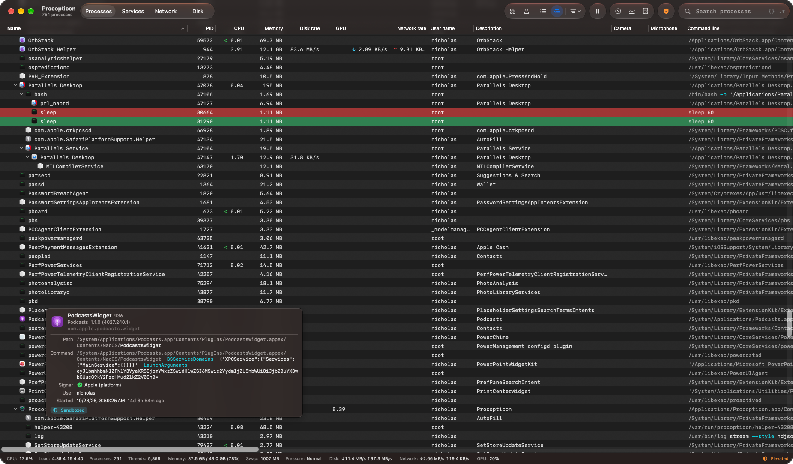
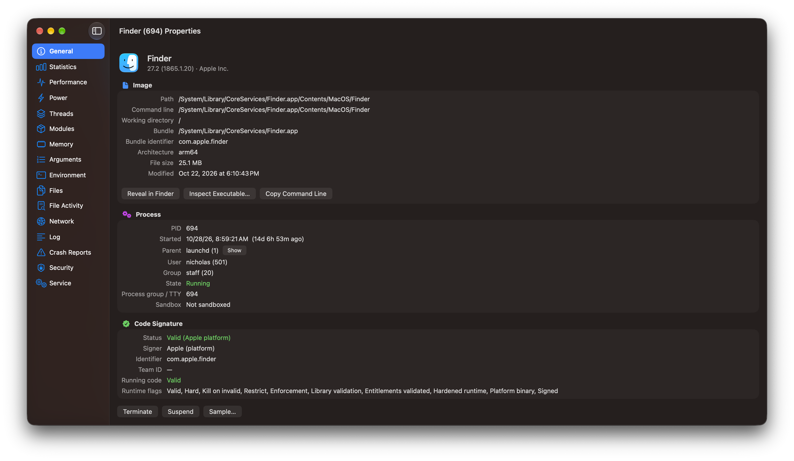
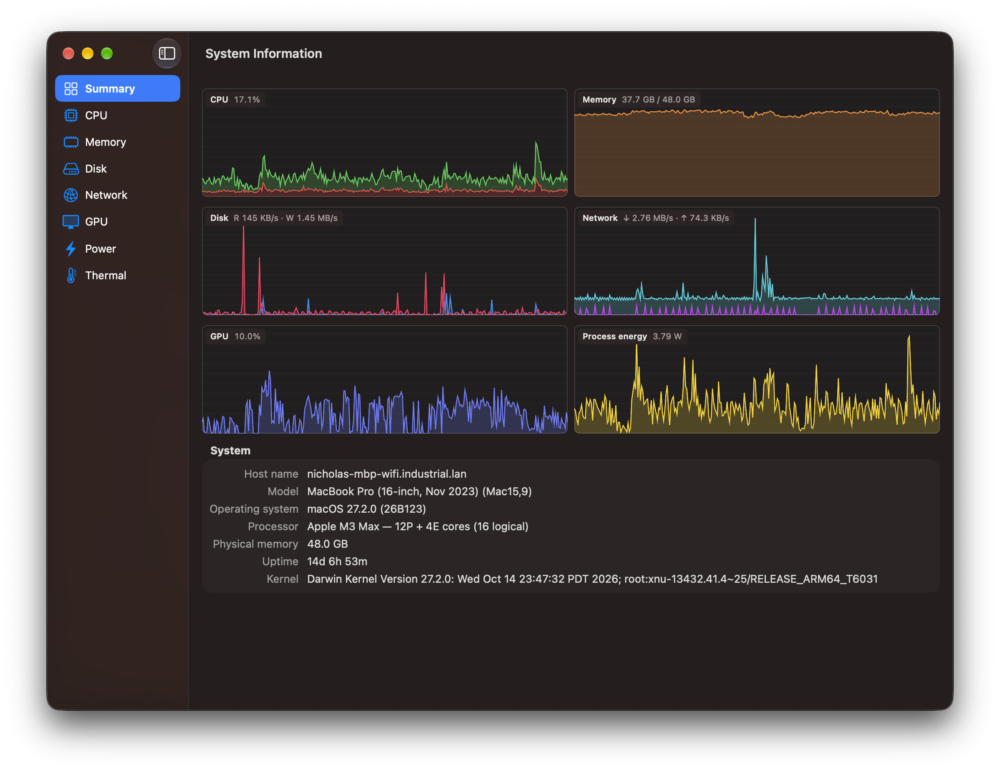
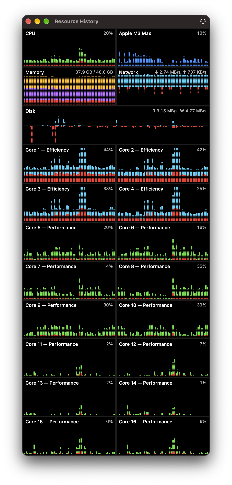

# Procopticon

*Every process, in plain sight.*

A native process explorer for macOS, built around the system's own concepts: launchd, Mach-O, code
signing, sandboxing, Rosetta, BSD signals and `nice` priorities.

It's written in Swift and SwiftUI, with a small C layer over `libproc`, `sysctl`, Mach host statistics
and IOKit. The large lists are AppKit `NSOutlineView`s so that thousands of rows can refresh every
second.



## Features

### Process list

The main window is a live process tree. Applications appear under their app name (Parallels Desktop
rather than `prl_client_app`). As in Activity Monitor, processes that launchd started on an app's
behalf, such as XPC services and daemonized helpers, are listed under the app responsible for them.

There are about 95 columns, most of them optional. Right-click the header to choose them. Among them:

| | Columns |
| --- | --- |
| CPU | Usage and CPU time (user/kernel), cycles, instructions and IPC |
| Scheduling | Threads, context switches, system calls, wake-ups, nice/priority, Mach ports and messages, open files |
| Memory | Physical footprint, peak, wired, compressed and purgeable memory, resident and virtual size, page faults, jetsam priority band and memory limit |
| Disk and network | Disk read/write rates, network send/receive rates (separately, or together with ↓/↑ arrows in Network rate), bytes and packets sent and received (from `nettop`) |
| GPU and power | GPU usage and GPU time, energy and power, power assertions, Preventing Sleep (whether the process keeps the Mac or its display awake) |
| Identity | User, parent and responsible PID, start time, command line, process title, description, bundle identifier and version, architecture (arm64 or Rosetta) |
| Security | Sandbox, code-signing verification and signer, team ID, the Download source of quarantined software |
| Privacy | Microphone, Camera, Screen recording |
| History graphs | CPU, memory, disk, GPU, network |

Hover over a cut-off value to see all of it.

The Process title column shows the title a process gave itself by overwriting its first argument
(Node's `process.title`, `setproctitle`, "postgres: checkpointer"). It stays empty for processes
started under their own name, a symlink or a shim.

The Microphone, Camera and Screen recording columns show which processes are using them. Microphone
use comes from Core Audio, per process. macOS has no API that says which app is using the camera or
recording the screen, so those come from the attributions Control Center logs for its privacy
indicators (followed with `log stream`, which needs an administrator account). The Event Log records
each start and stop.

Click the CPU, Memory, Disk, Network or GPU figures in the status bar to open a summary panel above
it, like the one at the bottom of Activity Monitor: totals and rates beside a history graph (CPU load,
memory pressure, disk IO or data, network packets or data, GPU). Click again to close it.

### Search and filters

Search by name, PID, path, command line, user or bundle ID. Every search and filter field also takes
regular expressions: click `.*` at the right end of the field, use *View ▸ Use Regular Expressions in
Search* (⌥⌘R), or write `/pattern/` at any time. Patterns are case-insensitive unless you write
`/pattern/c`. An invalid pattern is reported in the status bar.

The process list can also be searched with a [JavaScript expression](#expressions). Click `{}` in the
search field or use *View ▸ Use JavaScript in Process Search* (⌥⌘J), then type something like
`cpu > 10 && user == "root"` or `memory > 1 * GB && !appleSigned`.

The toolbar has quick filters: Apps (GUI applications and the processes they started), Mine (your
processes only), Tree/List, and a Filters menu that hides root/system, Apple-signed or zombie
processes, or shows only applications that aren't responding. While a filter is active, the status bar
reads "Showing N of M" with a Clear Filters link.

To see one process and its descendants on their own, right-click it and choose *Focus*. The search and
other filters still apply within the focused tree. Choose *Focus* again, *Filters ▸ Stop Focusing* or
Clear Filters to show every process again. Focus also ends once the process has exited and left the
list.

A saved filter is a search plus filter settings under a name. Apply one from the Filters menu or from
*View ▸ Saved Filters* (⌃⌘1–9). *Settings ▸ Filters* is where you create one from the current state,
edit, duplicate, reorder or delete them.

### Highlighting and alerts

Rows are highlighted for processes that are new or terminated, not responding, recording (microphone,
camera, screen), stopped, zombies, traced, running under Rosetta, elevated (setuid/sudo), unsigned or
sandboxed, and for applications, your own processes, root's and service accounts'. Colors and
priorities are configurable. You can add rules of your own in *Settings ▸ Highlighting*, each one a
[filter](#filters) and a color, such as the JavaScript expression `memory > 2 * GB` in red.

An application that has stopped responding to events (the spinning wait cursor) reads "(Not
Responding)" after its name, as in Activity Monitor. The Responding column says how long it has been
hung, *Filters ▸ Only Applications Not Responding* lists just those, and the Event Log records when an
app stops and starts responding again.

Alerts (*Settings ▸ Alerts*) are rules that post a notification when a process stays over a CPU,
memory, disk, network or GPU threshold for a given time, starts, exits, stops responding, keeps the
Mac awake, uses the microphone, camera or screen recording, or matches a [filter](#filters) of your
own, such as `cpu > 50 && memory > 2 * GB`. A rule can watch every process or only those matching its
filter. Clicking a notification selects the process, and every alert is recorded in the Event Log.

### Actions

* Terminate, Terminate Tree, Force Kill, Suspend/Resume (also for a whole tree) and Restart.
* Send any signal, set the `nice` value, or switch background (throttled) scheduling.
* Bring an app to the front or quit it gracefully.
* Reveal in Finder, inspect the executable, search online, copy values, go to the parent or the
  responsible process.
* Diagnostics: `sample`, `spindump`, `vmmap`, `footprint`, `heap`, `leaks`, `lsof`, live file activity
  (`fs_usage`) and core dumps. These run elevated automatically when they need to.

Anything that signals or reschedules a process checks its start time just before it acts. A
confirmation or password prompt can stay open for a while, and if the process has exited in the
meantime and its PID now belongs to another process, that process is left alone and you're told the
original has exited.

### Appearance

The toolbar is customizable (*View ▸ Customize Toolbar…*). By default the buttons are right-aligned and
arranged in groups: Quick Filters, Updates, Tools and Privileges. The palette has more groups (Process
Actions, Inspection Windows, Files & Programs), every individual button including Refresh and
Settings, Space, Flexible Space and the search field.

*Settings ▸ Appearance* has an optional fixed-width font and font size for the process list, and the
choice of System (follows macOS), Light or Dark, which is also in *View ▸ Appearance*. You can also
hide other users' processes, system processes, Apple-signed processes or zombies, or switch to a flat
list.

### Process properties

A process's properties open in their own window, with a sidebar of sections:



| Tab | Contents |
| --- | --- |
| General | Image, command line, process title, working directory, parent and responsible process, user and code signature. For downloaded software, its quarantine flag: which app downloaded it and when, whether you approved opening it, and the download URL and page when recorded |
| Statistics | CPU, memory, I/O, Mach message, system call and energy counters |
| Performance | CPU, memory and disk graphs |
| Power | Power assertions the process holds, or that another process holds for it (coreaudiod while it plays sound, say): type, name, how long, timeout and details |
| Threads | Live thread list; double-click a thread to capture its stack |
| Modules | Loaded images, including the dyld shared cache |
| Memory | VM regions with type, protection, share mode, and resident, dirty and swapped sizes |
| Arguments | The command line, one argument per row. For a process that replaced its arguments with a title, the arguments as launched, if Procopticon saw it start |
| Environment | Environment variables |
| Files | Open file descriptors: files, sockets, pipes, kqueues and shared memory |
| File Activity | The files the process opens, reads, writes and looks up, live (`fs_usage`, as root). Each call is shown with its file (named from the descriptor when the call doesn't say), bytes, duration and error, or the calls are summed up by file. Also in the process menu under Diagnostics |
| Network | The process's sockets |
| Log | The process's messages in the unified log: the last five minutes, then live (`log stream`), with a Default/Info/Debug level, pause, filter and earlier history (`log show`). Errors and faults are highlighted |
| Crash Reports | macOS's crash, exception, hang, resource (CPU, disk writes, wake-ups) and jetsam reports for the executable; double-click one to read it |
| Security | Credentials and groups, signing details, certificate chain and entitlements |
| Service | The launchd job that owns the process |

### Services, Network and Disk

The Services tab lists every launchd job in the system domain and in your GUI domain: daemons, agents,
login items and XPC services, loaded or not, with their PID, status, last exit code, start conditions
and enabled state. You can Start, Stop, Restart, Load (bootstrap), Unload (bootout), Enable or Disable
a job, and view its live `launchctl print` state or its property list.

The Network tab shows all TCP and UDP endpoints with the owning process, reverse-DNS host names and
well-known service names. New and closed connections are highlighted.

The Disk tab shows per-process disk throughput and totals, with history graphs.

### System Information



* Summary: the Mac's model name ("MacBook Pro (16-inch, Nov 2023)") and identifier, macOS, processor,
  memory and uptime.
* CPU: total plus one graph per core, labeled P or E from each core's type in the IORegistry. Hovering
  over a point shows the busiest process at that moment. Also the processor's core types with their L1
  and L2 caches, the cache line size and, when elevated, each cluster's current frequency.
* Memory: app, wired, compressed, cached and free memory, plus pressure, swap, page-in/out and
  compression rates, and the memory installed and usable by macOS.
* Disk: throughput and capacity of each volume, its format, and whether it's internal, external,
  removable or on the network, encrypted or read-only.
* Network: throughput of each interface, with its IP addresses, hardware address, MTU and link speed.
* GPU: utilization, core count and memory use, and the processes using the GPU. From Metal: unified or
  dedicated memory, recommended working set, largest buffer, Metal support (Apple GPU family, Metal 3
  or 4), hardware ray tracing and threadgroup limits.
* Power: battery state, estimated process power, power measured by `powermetrics` when elevated, and
  the processes keeping the Mac or its display awake.
* Thermal: the thermal state macOS reports (Nominal, Fair, Serious, Critical) with its history. From
  `powermetrics` (as root, while the section is open): thermal pressure, each CPU cluster's frequency
  and activity, the GPU's frequency, and CPU, GPU and Neural Engine power.

### Resource History

*View ▸ Resource History* (⌥⌘G, or the Tools toolbar group) opens a floating, resizable window of
history graphs like Activity Monitor's, all in one place. There is one graph per CPU core, with user
time (green on performance cores, cyan on efficiency cores) stacked over system time in red, plus the
GPU and memory (wired, compressed and app memory). Total CPU, network and disk graphs are optional. Choose
the graphs from the ⋯ button in the title bar or by right-clicking. The graphs rearrange into columns
as you resize the window. It stays above other windows unless you turn off *Always on Top* in the same
menu, and it reopens at launch if it was open when you quit.



### Tools

* Find Files or Libraries searches the open files and mapped images of every process, like `lsof`.
* Inspect Executable is a Mach-O viewer: the header and architecture slices, load commands, segments
  and sections, linked libraries, symbols, strings, code signature, quarantine, entitlements and the
  embedded Info.plist. Its Strings page lists the text in each section with its address. C-string
  sections (`__cstring`, `__objc_methname`, `__oslogstring`…) are split at their terminators as UTF-8,
  `__ustring` as UTF-16, and elsewhere it finds printable ASCII runs the way `strings(1)` does. Code,
  stubs, pointer tables and `__LINKEDIT` (whose symbols are on the Symbols page) are skipped. You can
  show one section, set a minimum length, filter and copy.
* Crash Reports lists every crash, exception, hang, resource and jetsam report in the user and system
  DiagnosticReports folders (including Retired ones), grouped by process so the apps that keep
  crashing stand out. JSON crash reports open laid out like classic crash logs: exception, termination
  reason, every thread's backtrace with the crashed one first, and the binary images. Any report can
  be opened in Console or revealed in Finder from its menu.
* Startup Items shows what starts code outside launchd's job list. See [below](#startup-items).
* Event Log records process start/exit, service start/stop, apps that stop or start responding,
  processes that start or stop keeping the Mac awake, alerts, and actions you take.
* *File ▸ Export Process List…* (⌘S) saves the process list as shown (its visible columns and rows,
  filtered and sorted) as JSON, the default, or CSV, chosen in the save panel. Values are raw rather
  than formatted: bytes, bytes per second, percentages, seconds and ISO 8601 dates, with the units in
  the JSON's `units` object and in the CSV's column headers. Values that couldn't be read are null
  (empty in CSV). In CSV, text that a spreadsheet would take for a formula (it starts with `=`, `+`,
  `-` or `@`, as `-zsh` does) gets an apostrophe in front.
* Also: Find Process by Window, Logged-in Users, Purge Disk Cache and Flush DNS Cache, and in the File
  menu Run Program and Run Program as Root.

A menu bar graph (CPU, memory, network or disk) opens a popover showing the top processes. It goes
well with *Settings ▸ General ▸ Open Procopticon at login*, which adds the app to *System Settings ▸
General ▸ Login Items*. If macOS asks for approval, a button opens those settings.

### Startup Items

A tree of what starts code outside launchd's job list (the Services tab covers that), in the manner
of Autoruns or KnockKnock:

* Open at Login apps
* login items and background items from Background Task Management (`sfltool dumpbtm`), with their
  app, developer, and whether they're allowed in Login Items settings
* Quick Look, Spotlight and Dock tile extensions
* system and kernel extensions
* cron jobs, periodic scripts, login and logout hooks
* authorization plug-ins
* plug-ins that load into other processes (input methods, screen savers, audio and camera drivers…)
* configuration profiles and legacy startup items

Apple's own are hidden unless you ask. Every user's cron jobs and the login hooks need the elevated
helper.

Right-click items to Disable, Enable or Remove… them (⌫ removes too):

| Item | Disable / Enable | Remove |
| --- | --- | --- |
| Open at Login apps | Taken off the list and remembered here, so they stay listed / put back | Taken off the list |
| Login and background items (agents, daemons) | `launchctl disable` / `enable` on the job | Ones with their own property list: unloaded, and the list moved to the Trash. Items an app registered itself are removed by the app |
| Quick Look and Spotlight extensions | `pluginkit -e ignore` / `use`, for you | — |
| Cron jobs | Commented out with a marker / restored | The line is deleted |
| Periodic scripts | Execute permission off / on | Moved to the Trash |
| Login and logout hooks | — | The setting is deleted (the script stays) |
| Plug-ins, legacy startup items | — | Moved to the Trash |
| Configuration profiles | — | `profiles remove` |

Disabling doesn't stop what's already running; it keeps the item from starting again. Changes to your
own items run as you. The rest go through the helper, which only changes files in the startup and
plug-in folders. Authorization plug-ins, system extensions and kernel extensions are listed but left
alone: removing an authorization plug-in the system still uses can stop anyone from logging in.

## Filters

Saved filters, custom highlight rules and alerts (*Settings ▸ Filters*, *Highlighting* and *Alerts*)
each have a filter with three tabs:

* Text matches anywhere in the name, path, command line, title, user, app name or bundle ID, ignoring
  case, or the PID exactly. `/pattern/` is a regular expression here too.
* Regex is a regular expression (ICU syntax, case-insensitive; `(?-i)` makes the rest case-sensitive).
* JavaScript is an [expression](#expressions) over the process's values.

The search field has the same three modes: plain text, `.*` and `{}`.

The editor is fixed-width and colors the syntax of regular expressions and JavaScript, including the
pattern inside a JavaScript regex literal (`/helper/i.test(name)`). It marks in red a parenthesis that
closes nothing or is never closed, a quantifier with nothing to repeat and an unfinished character
class. Under the editor, the filter's error, or the number of running processes it matches, updates as
you type.

JavaScript, here and in the search field's `{}` mode, has completion. A list follows the word you
type: the process's values, `KB`…`TB`, a few keywords, `Math` and `Date`, and after a dot the methods
of what's before it when its type is known (`name.` lists string methods, `args.` array ones, `/re/.`
`test` and `exec`).

* ↑ and ↓ choose, Tab or Return accepts, Esc closes the list.
* Tab on a partial word completes it at once when only one thing fits.
* With no list showing, ⌃Space opens it with everything that fits, even before you've typed anything.
  So does Esc in Settings; in the search field Esc clears the search. If ⌃Space switches input sources
  (*System Settings ▸ Keyboard ▸ Keyboard Shortcuts ▸ Input Sources*), macOS takes it first.

Settings saved by earlier versions, where an expression was written `=expression`, are converted.

## Expressions

JavaScript filters are evaluated for each process. The process's values are variables, so
`cpu > 50 && /helper/i.test(name)` matches busy helpers. *View ▸ Expression Reference* lists them all,
and the ? button above a JavaScript filter shows the same list.

| | Values |
| --- | --- |
| Identity | `pid` `ppid` `pgid` `responsiblePid` `name` `executable` `path` `commandLine` `args` (array) `title` `description` `user` `uid` `realUser` `group` `bundleId` `version` `company` `teamId` `arch` `tty` `state` |
| Resource use | `cpu` `cpuUser` `cpuKernel` (percent, as shown) `cpuTime` (seconds) `memory` `peakMemory` `resident` `virtualSize` `wired` `compressed` `purgeable` `memoryLimit` (bytes) `jetsamPriority` `gpu` `diskRate` `diskReadRate` `diskWriteRate` `netRate` `netInRate` `netOutRate` (bytes/s) `diskRead` `diskWrite` `netIn` `netOut` (bytes) `threads` `runningThreads` `fds` `ports` `priority` `nice` `power` (W) `age` (seconds) `startTime` (Date) |
| State (true/false) | `app` `mine` `exited` `notResponding` `preventingSleep` `microphone` `camera` `screenRecording` `stopped` `zombie` `traced` `translated` `elevated` `sandboxed` `signed` `appleSigned` `platformBinary` `hardenedRuntime` `quarantined` |

`KB`, `MB`, `GB` and `TB` are byte units (1 KB = 1024 bytes). Text that isn't known is empty; numbers
and true/false values that aren't known are `null`. Errors are reported in the status bar, or under
the rule in Settings. Error positions refer to your expression, so `cpu > 5)` reports the extra `)` at
column 8.

Expressions run in [QuickJS-ng](https://github.com/quickjs-ng/quickjs) (MIT; `Sources/CQuickJS/quickjs`,
unmodified) and not in the system's JavaScriptCore. A saved highlight rule with an endless loop would
otherwise hang the app every time it launched: QuickJS can stop a script that runs too long and cap
its memory, and JavaScriptCore has no public API for either.

The process store, the alerts and Settings each have their own engine, a separate context with no
access to files, the network or timers, limited to 32 MB. An expression that runs for more than
250 ms on one row, or 500 ms within a second over the whole list, is stopped and not run again until
it changes.

Fields are read only when an expression uses them. Over 800 processes, `cpu > 5` takes about 0.1 ms
and an expression testing names, users and paths under 1 ms, on the background queue that builds each
update.

## Responsiveness

Sampling, delta computation, filtering and tree building run on a background queue. Each update
publishes immutable snapshots, so the main thread only swaps them in. Tables sort on a background
queue and update incrementally: flat lists rebind row slots, and trees apply moves, inserts and
removes instead of reloading. Tied rows sort stably so they don't jitter. Icons, bundle metadata and
code-signing checks load asynchronously.

Memory-region scans of other processes (the Memory and Modules tabs, and library search in Find Files)
run in a disposable child process, because on recent macOS releases the kernel can kill the *caller*
of that query with `EXC_GUARD` for some targets.

## Privileges

macOS only lets an unprivileged process fully inspect processes that run as the same user. Procopticon
runs in one of three modes. The current mode appears at the right end of the status bar.

| Mode | How | Behaviour |
| --- | --- | --- |
| Standard | Normal launch | You see your own processes in full and other processes in outline. If an action is denied, you are asked for an administrator password once, which starts the helper. |
| Elevated helper | Toolbar shield button, *File ▸ Show Details for All Processes*, or *Settings ▸ Privileges ▸ Authorize at launch* | `procopticon-helper` runs as root and does the privileged work for the app. It exits when the app quits. |
| Root ("sudo mode") | `sudo "/Applications/Procopticon.app/Contents/MacOS/Procopticon"` or *File ▸ Relaunch as Root…* | The whole app runs as root. Everything executes in-process and you are never prompted. Your own processes are still recognized through `SUDO_UID`. |

The helper is started through the standard macOS authorization dialog, or with `sudo -n` and no dialog
if `sudo` needs no password. Root runs a copy of the helper that it has placed where only root can
change it, after checking that the copy is signed by the same developer as the app. The helper listens
on a `0600` Unix socket in `/var/run/procopticon`, which only root can write to, and serves exactly
one client: every connection is checked against the app's PID and UID. It does what the app asks of
it, including running programs as root, so see [SECURITY.md](SECURITY.md) for what that does and
doesn't protect against.

System Integrity Protection still applies in every mode. Apple platform binaries cannot be attached
to, but `sample`, `vmmap` and libproc data remain available for them when you run as root.

## Building

You need Xcode 26 or later and macOS 26 or later (the project was developed with Xcode 27 on macOS 27).

```sh
./scripts/build-app.sh               # release build → build/Procopticon.app, signed with your
                                     # Developer ID certificate if you have one, otherwise ad-hoc
SIGN_IDENTITY="Apple Development: …" ./scripts/build-app.sh   # sign with another certificate (- for ad-hoc)
./scripts/install.sh                 # the same build, installed into /Applications (INSTALL_DIR=… for
                                     # somewhere else) and opened (--no-open not to)
swift test                           # unit tests for the samplers and parsers
VERSION=1.0.0 ./scripts/release.sh   # universal, Developer ID-signed and notarized → build/Procopticon-1.0.0.dmg
```

`release.sh` is for the copy handed to other people. It needs a Developer ID Application certificate
and notarization credentials in the keychain; the top of the script says how to set them up.

You can also use `swift build` and `swift run Procopticon` while developing.
`VARIANT=dev ./scripts/build-app.sh` builds **Procopticon Dev.app**. It has its own bundle
identifier, executable name and preferences, so it can run next to the installed app without
sharing settings or window positions.

Launch arguments are useful for scripting and testing:

```text
--elevate                    authorize at startup
--search <text>              pre-fill the process search (e.g. '/^mdworker/')
--select <pid>               select a process in the list
--tab processes|services|network|disk
--show-properties <pid>      [--properties-tab General|Threads|Modules|Memory|Files|…]
--show-sysinfo summary|cpu|memory|disk|network|gpu|power|thermal
--show-find <text>    --inspect <path>    --show-service <label>
--show-history    --show-settings    --show-log    --show-windows    --show-crashes    --show-startup
```

## Layout

```text
Sources/CSysInfo            C: libproc/sysctl/Mach/IOKit wrappers (processes, FDs, sockets, threads, VM regions, host stats)
Sources/CQuickJS            C: QuickJS-ng (quickjs/, vendored unmodified; see quickjs/VERSION) and a small bridge for
                            evaluating expressions over rows of fields
Sources/ProcopticonExpressions  Swift: the expression engine and the process fields expressions use. Kept out of
                            ProcopticonCore so the root helper carries no JavaScript engine
Sources/ProcopticonCore     Swift: samplers, process/network stores, launchd services, code signing, Mach-O parser,
                            privileged request protocol, executor, helper transport, elevation broker
Sources/procopticon-helper  Root helper executable
Sources/Procopticon         SwiftUI/AppKit app
Tests/ProcopticonCoreTests  Unit tests
Resources/AppIcon.icon      App icon (Icon Composer; open it there to edit). macOS draws the shape, shadow and the
                            Dark, Clear and Tinted styles; build-app.sh compiles it with actool.
Resources/AppIcon-artwork.png  The flat artwork. scripts/split-icon.py splits it into the icon's layers (waveform,
                            blips, bezel, sweep, screen) and regenerates AppIcon.icon.
docs/screenshots            The screenshots in this README
```

## Contributing

See [CONTRIBUTING.md](CONTRIBUTING.md) for building, testing and what a change should look like,
[AI-POLICY.md](AI-POLICY.md) for AI-assisted contributions, and [SECURITY.md](SECURITY.md) for
reporting a vulnerability and for what the elevated helper does and doesn't protect against.

## License

Procopticon is released under the [MIT License](LICENSE). It includes
[QuickJS-ng](https://github.com/quickjs-ng/quickjs), also MIT licensed; see
[THIRD_PARTY_NOTICES.md](THIRD_PARTY_NOTICES.md). Both licenses are shown in *Procopticon ▸ About
Procopticon*.

Procopticon uses undocumented macOS interfaces for some of what it shows, so it can't be distributed
through the Mac App Store.
