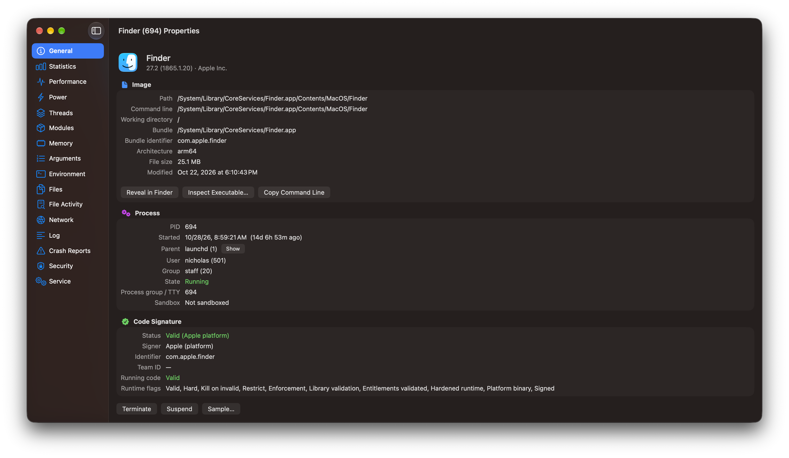
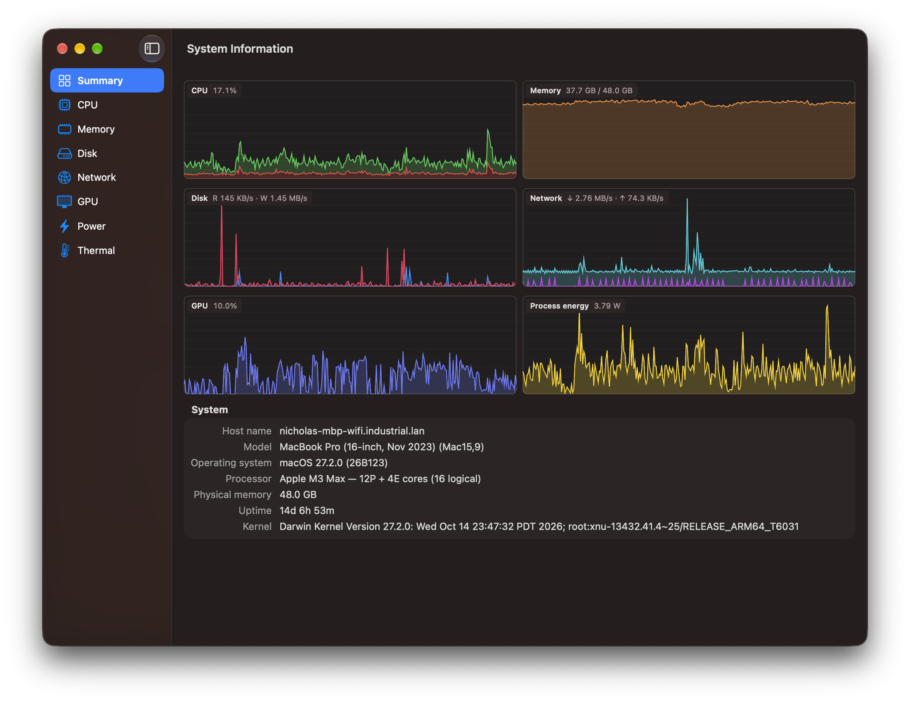
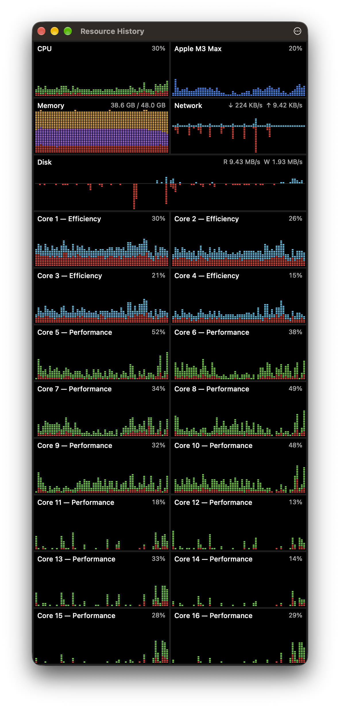

# Procopticon reference

- [Process list](#process-list)
  - [Columns](#columns)
  - [Search](#search)
  - [Quick filters and Focus](#quick-filters-and-focus)
  - [Saved filters](#saved-filters)
  - [Highlighting](#highlighting)
  - [Alerts](#alerts)
  - [Actions](#actions)
  - [Status bar](#status-bar)
- [Filters](#filters)
- [Expressions](#expressions)
- [Process properties](#process-properties)
- [Services, Network, and Disk tabs](#services-network-and-disk-tabs)
- [System Information](#system-information)
- [Resource History](#resource-history)
- [Tools](#tools)
  - [Startup Items](#startup-items)
- [Appearance and toolbar](#appearance-and-toolbar)
- [Privileges](#privileges)
- [Launch arguments](#launch-arguments)
- [Building](#building)

## Process list

The main window shows a live process tree. Applications are listed by their actual app names (for example, Parallels Desktop instead of `prl_client_app`). XPC services and other helpers launched on an application's behalf are grouped under that application, similar to Activity Monitor.

### Columns

There are roughly 100 available columns. Most are hidden by default; right-click a column header to pick the ones you want. Hover over a truncated value to see it in full.

| | Columns |
| --- | --- |
| CPU | Usage, user/kernel CPU time, cycles, instructions, IPC |
| Scheduling | Threads, context switches, system calls, wake-ups (in total, and idle and interrupt wake-ups apart), nice/priority, Mach ports and messages, open files |
| Memory | Physical footprint, peak, wired, compressed, purgeable, resident and virtual memory, page faults, jetsam priority band and memory limit |
| Disk and network | Read/write and send/receive rates, total bytes and packets, including `nettop` counters. The Network rate column can combine inbound/outbound traffic using ↓/↑ arrows |
| GPU and power | GPU usage and time, power now and averaged since the process started, energy used and energy billed to it for work done on its behalf, power assertions, and whether a process is preventing sleep |
| Identity | User, parent/responsible PID, start time, command line, process title, description, bundle ID and version, architecture (arm64/Rosetta) |
| Security | Sandbox status, code signature verification, signer, team ID, and quarantine download source |
| Privacy | Microphone, camera and screen recording activity |
| History | CPU, memory, disk, GPU, network and power graphs |

**Process title** is separate from the executable name. It reports the title a process sets by replacing its first argument, as with Node's `process.title`, `setproctitle`, or `postgres: checkpointer`. It is blank for processes that haven't set a title, including those launched through a symlink or shim.

The **Microphone**, **Camera**, and **Screen recording** columns identify processes using those resources. Microphone activity comes from Core Audio. macOS doesn't provide a direct API for camera and screen recording attribution, so Procopticon follows the Control Center privacy-indicator logs using `log stream`. That requires an administrator account. Starts and stops are also recorded in the Event Log.

The **Sandboxed** column says whether a process runs in the App Sandbox. To see that without giving it a column, turn on *Settings ▸ Appearance ▸ Badge sandboxed processes*: each sandboxed process then has a small shield after its name, the one its hover card shows beside *Sandboxed*.

The **Responding** column shows how long a hung application has been stuck. Its name also gains *(Not Responding)*, and the Event Log records when it stops and resumes responding.

### Search

Search processes by name, PID, path, command line, user, or bundle ID. The search field has three modes:

| Mode | How to turn it on | Notes |
| --- | --- | --- |
| Plain text | The default | |
| Regular expression | Click `.*`, choose *View ▸ Use Regular Expressions in Search* (⌥⌘R), or enter `/pattern/` | Ignores case by default; `/pattern/c` is case-sensitive. An invalid pattern produces an error in the status bar |
| JavaScript | Click `{}` or choose *View ▸ Use JavaScript in Process Search* (⌥⌘J) | An [expression](#expressions) such as `cpu > 10 && user == "root"` or `memory > 1 * GB && !appleSigned` |

While it has the keyboard focus, the field colors what you type the way the [filter editor](#filters) does: the parts of a regular expression, JavaScript's values, strings and numbers, and a `/pattern/` in plain text.

### Quick filters and Focus

The toolbar narrows the list:

- **Apps** shows GUI applications and the processes they started.
- **Mine** shows only your processes.
- **Tree/List** switches between the process hierarchy and a flat list.
- **Filters** can hide root/system, Apple-signed, or zombie processes, or show only unresponsive applications (*Only Applications Not Responding*).

With filters active, the status bar displays *Showing N of M* and a **Clear Filters** link.

To isolate a process and its children, right-click it and select *Focus*. Your other search and filter settings still apply. Select *Focus* again, use *Filters ▸ Stop Focusing*, or click *Clear Filters* to return to the full list. Focus also ends when that process exits and disappears from the list.

### Saved filters

Searches and filter settings can be saved together under a name. Apply them from the Filters menu or *View ▸ Saved Filters* (⌃⌘1–9). Create, edit, duplicate, reorder, and delete saved filters in *Settings ▸ Filters*, using the [filter editor](#filters).

### Highlighting

Rows are highlighted by process state: newly started or terminated, hung, stopped, zombie, traced, running through Rosetta, elevated through setuid/sudo, unsigned, sandboxed, or using the microphone, camera, or screen recording. Applications, your processes, root processes, and service accounts can be distinguished too.

A new install highlights the process kept in view and processes that are new, terminated, not responding, stopped, zombies, running through Rosetta, elevated, or using the microphone, camera, or screen recording. The other rules are off until you turn them on in *Settings ▸ Highlighting*.

Highlight colors and their priority are configurable. In *Settings ▸ Highlighting*, you can add custom rules, each a [filter](#filters) and a color. For example, `memory > 2 * GB` could highlight processes in red.

### Alerts

Alerts are configured under *Settings ▸ Alerts*. A rule posts a notification when a process:

- Exceeds a CPU, memory, disk, network, or GPU threshold for a specified duration
- Starts, exits, or stops responding
- Prevents the Mac from sleeping
- Uses the microphone, camera, or screen recording
- Matches a custom [filter](#filters), such as `cpu > 50 && memory > 2 * GB`

Each rule can apply to all processes or only those matching a filter. Clicking a notification selects the process, and alerts are also saved to the Event Log.

### Actions

Right-click a process for its actions:

- Terminate, Terminate Tree, Force Kill, Suspend/Resume (including a whole tree), or Restart
- Send a signal, change its `nice` value, or enable/disable background (throttled) scheduling
- Bring an application forward or ask it to quit normally
- Reveal the executable in Finder, inspect it, search online, copy values, or jump to its parent or responsible process
- Run diagnostics: `sample`, `spindump`, `vmmap`, `footprint`, `heap`, `leaks`, `lsof`, live file activity (`fs_usage`), or a core dump

Diagnostics request elevated privileges automatically when required.

Before signaling or changing the scheduling of a process, Procopticon checks its start time. This matters if a confirmation or password dialog has been open long enough for the original process to exit and macOS to reuse its PID. In that case, Procopticon leaves the new process alone and reports that the original exited.

### Status bar

The status bar shows system totals, the *Showing N of M* count while filters are active, search and expression errors, and the current [privilege mode](#privileges) at its right end.

Click the CPU, Memory, Disk, Network, or GPU figures to expand a panel with totals, rates, and a history graph. It's similar to the summary at the bottom of Activity Monitor. Click the figure again to close it.

## Filters

Saved filters, custom highlights, and alerts each use the same filter editor in *Settings ▸ Filters*, *Highlighting*, and *Alerts*. It supports three modes, the same three as the main search field:

| Mode | Matches |
| --- | --- |
| Text | Case-insensitive matching against name, path, command line, title, user, app name, or bundle ID, with exact PID matching. `/pattern/` works here too |
| Regex | ICU regular expressions, case-insensitive by default. Use `(?-i)` for case-sensitive matching |
| JavaScript | An [expression](#expressions) evaluated against process values |

The editor uses a fixed-width font and syntax highlighting. It flags unmatched parentheses, incomplete character classes, and quantifiers without anything to repeat. This applies to regex patterns inside JavaScript too, such as `/helper/i.test(name)`. Below the editor, you'll see either an error or a live count of matching processes.

JavaScript mode, in the editor and in the search field, has completion for process fields, `KB` through `TB`, keywords, `Math`, `Date`, and known methods on values (for example, string methods after `name.`, array methods after `args.`, and `test`/`exec` after a regex).

| Key | Effect |
| --- | --- |
| ↑ / ↓ | Select a suggestion |
| Tab or Return | Insert the selected suggestion. Tab completes a partial word immediately if there's only one match |
| Esc | Dismiss the list. With no list showing, Esc opens it in Settings and clears the search in the process search field |
| ⌃Space | Open all matching suggestions, even before you've typed anything. If ⌃Space is assigned to switching input sources under *System Settings ▸ Keyboard ▸ Keyboard Shortcuts ▸ Input Sources*, macOS handles that shortcut first |

Older saved expressions beginning with `=` are converted automatically.

## Expressions

JavaScript expressions are evaluated once per process, with process data available as variables. For instance, `cpu > 50 && /helper/i.test(name)` matches helper processes using more than 50% CPU. *View ▸ Expression Reference*, or the ? button above a filter, shows the full list in the app.

| | Values |
| --- | --- |
| Identity | `pid` `ppid` `pgid` `responsiblePid` `name` `executable` `path` `commandLine` `args` (array) `title` `description` `user` `uid` `realUser` `group` `bundleId` `version` `company` `teamId` `arch` `tty` `state` |
| Resource use | `cpu` `cpuUser` `cpuKernel` (percent, as displayed) `cpuTime` (seconds) `memory` `peakMemory` `resident` `virtualSize` `wired` `compressed` `purgeable` `memoryLimit` (bytes) `jetsamPriority` `gpu` `diskRate` `diskReadRate` `diskWriteRate` `netRate` `netInRate` `netOutRate` (bytes/s) `diskRead` `diskWrite` `netIn` `netOut` (bytes) `threads` `runningThreads` `fds` `ports` `priority` `nice` `power` (W) `age` (seconds) `startTime` (Date) |
| State (true/false) | `app` `mine` `exited` `notResponding` `preventingSleep` `microphone` `camera` `screenRecording` `stopped` `zombie` `traced` `translated` `elevated` `sandboxed` `signed` `appleSigned` `platformBinary` `hardenedRuntime` `quarantined` |
| Units | `KB` `MB` `GB` `TB` (1024-byte units) |

Unknown text fields return an empty string; unknown numeric and boolean fields return `null`.

Errors appear in the status bar or beneath the filter in Settings, with positions relative to the expression. For example, `cpu > 5)` reports the extra `)` at column 8.

Expressions can't access files, the network, or timers, and each engine is limited to 32 MB. An expression is stopped if it takes more than 250 ms on one row or 500 ms total in one second, and it won't run again until edited.

## Process properties

Open a process to inspect it in a separate window. Its sidebar contains the following sections.

| Tab | Contents |
| --- | --- |
| General | Executable image, command line, process title, working directory, parent/responsible process, user and code signature. For quarantined downloads, the downloading app, date, approval status, URL and source page when available |
| Statistics | CPU, memory, I/O, Mach messages, system calls, and energy counters |
| Performance | CPU, memory, and disk history graphs |
| Power | Power assertions held directly or on behalf of the process (for example by `coreaudiod` during playback), including type, name, duration, timeout, and details |
| Threads | Live thread list; double-click a thread to capture its stack |
| Modules | Loaded images, including the dyld shared cache |
| Memory | VM regions, protection, share mode, and resident, dirty, and swapped sizes |
| Arguments | One argument per row. If the process replaced its arguments with a title, the original arguments are available if Procopticon observed it starting |
| Environment | Environment variables |
| Files | Open file descriptors: files, sockets, pipes, kqueues, shared memory |
| File Activity | Live opens, reads, writes, and lookups from `fs_usage` (as root), with file, bytes, duration, and errors; optionally aggregated by file. Also available under Diagnostics |
| Network | Sockets owned by the process |
| Log | Last five minutes of unified log messages followed by live `log stream`, with Default/Info/Debug levels, pause, filtering, and older history via `log show`. Errors and faults are highlighted |
| Crash Reports | Crash, exception, hang, resource (CPU, disk writes, wake-ups), and jetsam reports; double-click to view |
| Security | Credentials, groups, code signing, certificate chain, and entitlements |
| Service | The launchd job associated with the process |

## Services, Network, and Disk tabs

The **Services** tab lists launchd jobs in the system and current GUI domains: daemons, agents, login items, and XPC services, including unloaded jobs. It displays PID, status, last exit code, start conditions, and whether each job is enabled. Jobs can be started, stopped, restarted, loaded (`bootstrap`), unloaded (`bootout`), enabled, or disabled. You can also view live `launchctl print` output or the job's property list.

The **Network** tab lists TCP and UDP endpoints, their owning processes, reverse-DNS hostnames, and recognized service names. New and closed connections are highlighted.

The **Disk** tab shows disk throughput and totals per process, with history graphs.

## System Information

| Section | Contents |
| --- | --- |
| Summary | Model name and identifier, macOS version, processor, memory, and uptime |
| CPU | Overall usage and a graph for each core, labeled P or E using IORegistry data. Hover over a point to see which process was busiest. Includes core types, L1/L2 cache sizes, cache line size, and (when elevated) current cluster frequencies |
| Memory | App, wired, compressed, cached, and free memory; pressure, swap, page-in/out, and compression rates; installed and usable memory |
| Disk | Per-volume throughput, capacity, format, and whether a volume is internal/external, removable/network, encrypted, or read-only |
| Network | Interface throughput, IP and hardware addresses, MTU, and link speed |
| GPU | Usage, core count, memory use, and processes using the GPU. Metal details include unified/dedicated memory, recommended working set, largest buffer, GPU family, Metal 3/4 support, hardware ray tracing, and threadgroup limits |
| Power | Battery state, estimated per-process power, power from `powermetrics` when elevated, and processes preventing system/display sleep |
| Thermal | macOS thermal state (Nominal, Fair, Serious, Critical) and its history. While open and running elevated, `powermetrics` adds thermal pressure, CPU cluster frequency and activity, GPU frequency, and CPU/GPU/Neural Engine power |

## Resource History

*View ▸ Resource History* (⌥⌘G), or the Tools toolbar group, opens a floating window with Activity Monitor-style graphs. CPU graphs are shown per core, with user time stacked over system time (green for performance-core user time, cyan for efficiency-core user time, red for system time). GPU and memory graphs are included, with wired, compressed, and app memory broken out. Total CPU, disk, and network graphs can be enabled as well.

Choose graphs using the ⋯ menu or by right-clicking. The layout adjusts as you resize the window. Resource History stays on top by default, though you can disable *Always on Top*. If it was open when you quit, it reopens the next time you launch Procopticon.

## Tools

These are in the Tools menu unless noted.

### Find Files or Libraries

Searches open files and mapped images across processes, similar to `lsof`.

### Inspect Executable

A Mach-O viewer: headers, architecture slices, load commands, segments, sections, linked libraries, symbols, strings, signatures, quarantine metadata, entitlements, and embedded Info.plist data.

The Strings page includes addresses and decodes `__cstring`, `__objc_methname`, `__oslogstring`, and similar sections as null-terminated UTF-8; `__ustring` as UTF-16; and other printable ASCII runs in the style of `strings(1)`. It skips code, stubs, pointer tables, and `__LINKEDIT` (symbols are on their own page). You can inspect one section at a time, set a minimum string length, filter, and copy results.

### Crash Reports

Lists crash, exception, hang, resource, and jetsam reports from user and system DiagnosticReports directories, including Retired reports, grouped by process. JSON crash reports are presented like traditional crash logs, with exception and termination details, thread backtraces (crashed thread first), and binary images. Open a report in Console or reveal it in Finder.

### Startup Items

Startup Items is similar in purpose to Autoruns or KnockKnock. It lists the ways software can start outside the launchd jobs already covered by the Services tab:

- Open at Login applications
- Login and background items reported by Background Task Management (`sfltool dumpbtm`), including their app, developer, and Login Items permission
- Quick Look, Spotlight, and Dock tile extensions
- System and kernel extensions
- Cron jobs, periodic scripts, login and logout hooks
- Authorization plug-ins
- Plug-ins loaded into other processes, including input methods, screen savers, audio and camera drivers
- Configuration profiles and legacy startup items

Apple's own items are hidden by default. Reading all users' cron jobs and login hooks requires the elevated helper.

Right-click an item to **Disable**, **Enable**, or **Remove…** it. The Delete key also removes an item.

| Item | Disable / Enable | Remove |
| --- | --- | --- |
| Open at Login apps | Remove from the login list but keep an entry here / add back | Remove from the login list |
| Login and background items (agents, daemons) | `launchctl disable` / `enable` | For jobs with their own property list, unload and move the plist to Trash. App-registered items are removed by their app |
| Quick Look and Spotlight extensions | `pluginkit -e ignore` / `use`, for the current user | — |
| Cron jobs | Comment out with a marker / restore | Delete the line |
| Periodic scripts | Remove / restore execute permission | Move to Trash |
| Login and logout hooks | — | Delete the setting (leave the script) |
| Plug-ins and legacy startup items | — | Move to Trash |
| Configuration profiles | — | `profiles remove` |

Disabling an item doesn't stop it if it's already running; it prevents it from starting again. Changes to your own items run with your privileges. Other changes go through the elevated helper, which only modifies files in the startup and plug-in directories.

Authorization plug-ins, system extensions, and kernel extensions are listed but can't be modified here. Removing an authorization plug-in that macOS still needs can prevent anyone from logging in.

### Event Log

Records process starts and exits, service starts and stops, apps becoming unresponsive or recovering, sleep-preventing processes, microphone, camera, and screen recording use, alerts, and actions performed in Procopticon.

### Export Process List

*File ▸ Export Process List…* (⌘S) exports the current visible, filtered, sorted rows and columns as JSON or CSV.

- Values use raw units: bytes, bytes/second, percentages, seconds, ISO 8601 dates.
- JSON includes a `units` object; CSV includes units in column headers.
- Unavailable values are `null` in JSON and empty in CSV.
- To prevent spreadsheet formula interpretation, CSV text starting with `=`, `+`, `-`, or `@` gets a leading apostrophe.

### Other commands

| Command | Menu |
| --- | --- |
| Find Process by Window | Tools |
| Logged-in Users | Tools |
| Purge Disk Cache | Tools |
| Flush DNS Cache | Tools |
| Stop Privileged Helper | Tools |
| Run Program, Run Program as Root | File |

### Menu bar graph

An optional menu bar graph shows CPU, memory, network, or disk usage. Clicking it opens a popover with the top processes. Enable *Settings ▸ General ▸ Open Procopticon at login* to add the app to macOS Login Items. If macOS requires approval, Procopticon can open the relevant settings page.

## Appearance and toolbar

The toolbar can be rearranged with *View ▸ Customize Toolbar…*. Its default groups are Quick Filters, Updates, Tools, and Privileges. The customization palette also includes Process Actions, Inspection Windows, Files & Programs, individual buttons such as Refresh and Settings, spacers, and the search field.

*Settings ▸ Appearance* lets you change the process-list font and size, including a fixed-width font, and the size of the icons beside process names, from the standard 16 points up to 32; rows grow taller to fit larger icons. *Badge sandboxed processes* is there too. You can select System, Light, or Dark appearance there or from *View ▸ Appearance*. Options to hide other users' processes, system processes, Apple-signed processes, and zombies, or to use a flat list, are also available.

## Privileges

macOS limits how much an unprivileged application can inspect other users' processes. Procopticon has three modes, shown at the right side of the status bar.

| Mode | How | Behavior |
| --- | --- | --- |
| Standard | Launch normally | Full details for your processes; limited details for others. If an action requires more access, Procopticon asks for an administrator password once and starts the helper. |
| Elevated helper | Toolbar shield, *File ▸ Show Details for All Processes*, or *Settings ▸ Privileges ▸ Authorize at launch* | `procopticon-helper` runs as root and performs privileged operations. It exits when the app quits. |
| Root (sudo mode) | `sudo "/Applications/Procopticon.app/Contents/MacOS/Procopticon"` or *File ▸ Relaunch as Root…* | The entire app runs as root. Operations run in-process without prompts. Your own processes are identified using `SUDO_UID`. |

The helper launches through the standard macOS authorization dialog. If `sudo -n` succeeds without a password, it can start without a dialog. It runs from a copy placed in a root-writable-only location after checking that the copy is signed by the same developer as the application.

Communication uses a `0600` Unix socket under `/var/run/procopticon`, a directory writable only by root. The helper accepts one client and checks each connection against the application's PID and UID. It can carry out privileged operations, including launching programs as root. Read [SECURITY.md](../SECURITY.md) for the security model and its limitations.

System Integrity Protection still applies in all three modes. Apple platform binaries can't be attached to, although `sample`, `vmmap`, and libproc information remain available when running as root.

## Launch arguments

For tests and scripts:

| Argument | Effect |
| --- | --- |
| `--elevate` | Authorize the helper at startup |
| `--search <text>` | Pre-fill the process search (for example `'/^mdworker/'`) |
| `--select <pid>` | Select a process in the list |
| `--tab processes\|services\|network\|disk` | Open on that tab |
| `--show-properties <pid>` | Open a process's properties; `--properties-tab General\|Threads\|Modules\|Memory\|Files\|…` picks the section |
| `--show-sysinfo summary\|cpu\|memory\|disk\|network\|gpu\|power\|thermal` | Open System Information on that section |
| `--show-find <text>` | Open Find Files or Libraries and search |
| `--inspect <path>` | Open Inspect Executable on a file |
| `--show-service <label>` | Open a launchd job's properties |
| `--show-history` | Open Resource History |
| `--show-settings` | Open Settings |
| `--show-log` | Open the Event Log |
| `--show-windows` | Open Find Process by Window |
| `--show-crashes` | Open Crash Reports |
| `--show-startup` | Open Startup Items |

## Building

Requires **Xcode 26 or later** and **macOS 26 or later**. Development has been done with Xcode 27 on macOS 27.

| Command | Result |
| --- | --- |
| `./scripts/build-app.sh` | Release build in `build/Procopticon.app`, signed with your Developer ID certificate if you have one, otherwise ad-hoc |
| `./scripts/install.sh` | The same build, installed to `/Applications` and opened |
| `swift test` | Sampler and parser unit tests |
| `swift build`, `swift run Procopticon` | Debug build without an app bundle, for development |
| `VERSION=1.0.0 ./scripts/release.sh` | Universal, signed, notarized `build/Procopticon-1.0.0.dmg` |

| Variable or option | Script | Effect |
| --- | --- | --- |
| `SIGN_IDENTITY="Apple Development: …"` | `build-app.sh`, `install.sh`, `release.sh` | Sign with that certificate; `-` for ad-hoc |
| `VARIANT=dev` | `build-app.sh` | Build **Procopticon Dev.app**, which has a separate bundle ID, executable name, and preferences, so it can run alongside the installed app without sharing settings or window positions |
| `CONFIG=debug` | `build-app.sh` | Debug instead of release |
| `UNIVERSAL=1` | `build-app.sh` | Build for Apple silicon and Intel |
| `INSTALL_DIR=…` | `install.sh` | Install somewhere other than `/Applications` |
| `--no-open` | `install.sh` | Don't launch after installing |
| `NOTARIZE=0` | `release.sh` | Stop after signing |

`release.sh` is intended for distribution. It requires a Developer ID Application certificate and notarization credentials in your keychain. Setup instructions are at the top of the script. The *Release* workflow (`.github/workflows/release.yml`, run by hand from the Actions tab) runs it on GitHub and publishes the disk image as a release.
